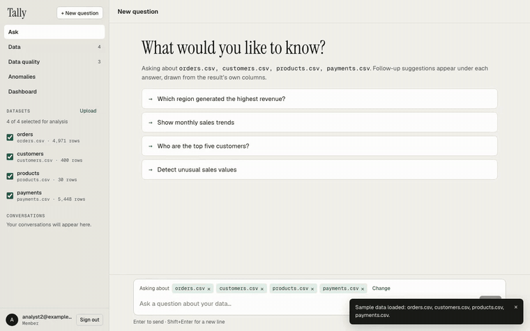
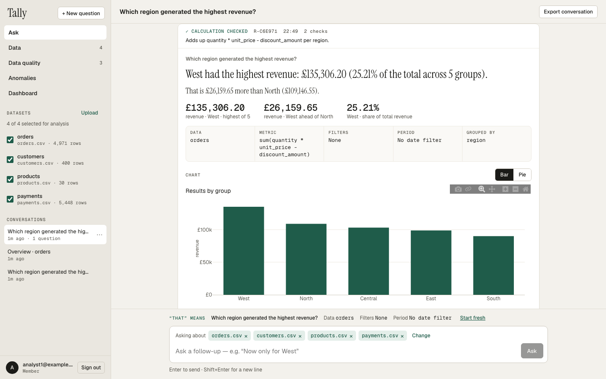
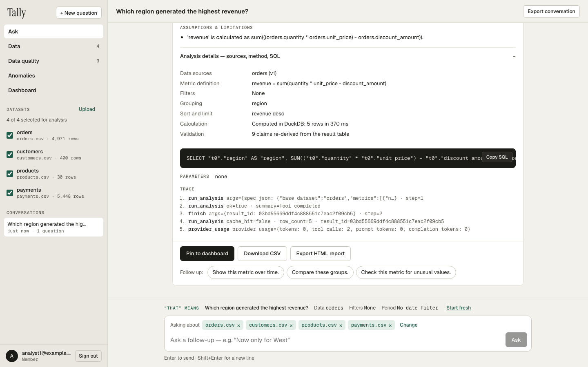
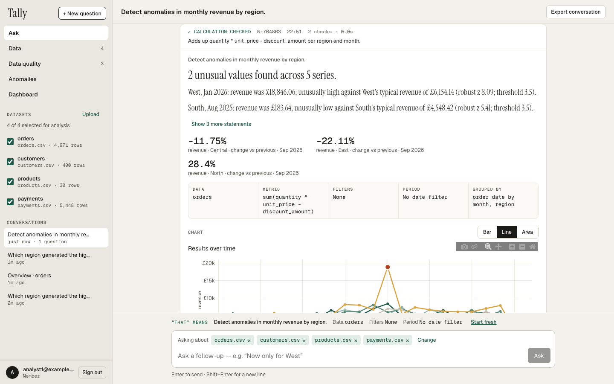
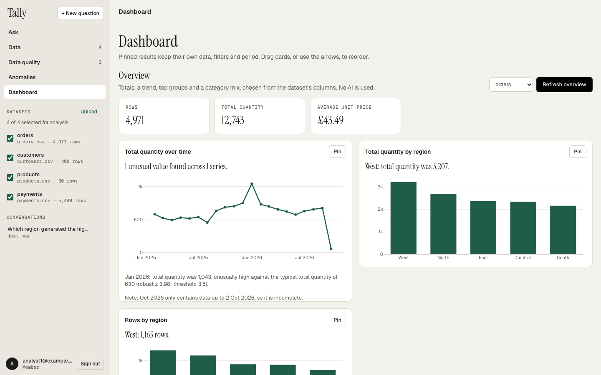
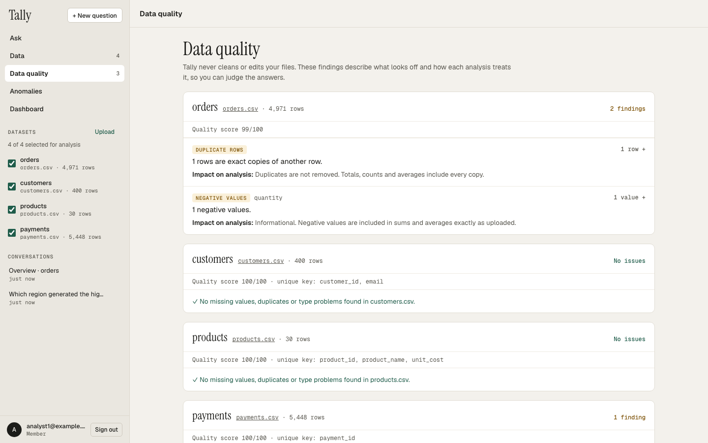
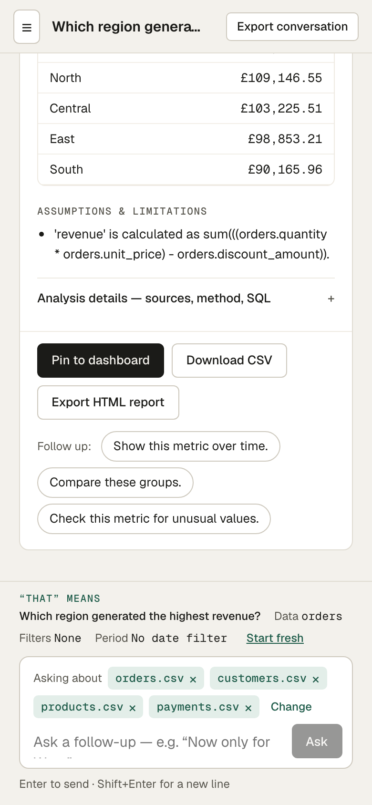
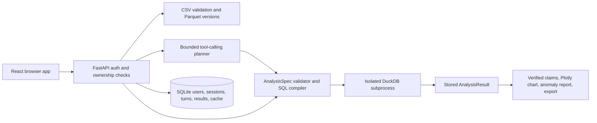

# Tally: AI Data Analyst

Upload one or more CSV files and ask questions in plain English. Tally answers with a short written conclusion, a chart, the result table, the **exact SQL and parameters** that produced it, the assumptions it made, and an explanation of any anomalies. Every figure you see is calculated by the backend and re-checked against the result table; the AI only chooses *which* calculation to run.



**Demo video (23 s):** [docs/demo.mp4](docs/demo.mp4): sign in, load sample data, ask a question, inspect the SQL and sources, detect anomalies, and generate the overview dashboard. *(The recording uses the built-in scripted AI provider, so it runs without an API key; every number in it is computed by the real analysis engine.)*

## Try it in three commands

```bash
cp .env.example .env            # add LLM_API_KEY for real AI answers (optional, see below)
docker compose up --build -d    # frontend and backend on http://localhost:8768
docker compose exec api app seed-demo   # needs DEMO_PASSWORD in .env; demo accounts below
```

No API key? Set `LLM_PROVIDER=fake` in `.env` to use the scripted provider (a fixed set of demo questions), or use the deterministic parts (uploads, data quality, anomaly explorer, the automatic overview dashboard, exports), which never call an AI. Demo accounts: `analyst1@example.com`, `analyst2@example.com`, `admin@example.com`.

## What it looks like

| | |
|---|---|
|  |  |
| **Answer:** one conclusion, one comparison, and what was calculated in plain words. | **How it was calculated:** exact SQL, parameters, sources and versions, and the tool trace. |
|  |  |
| **Anomalies** with their evidence: value, typical value, robust z and threshold. | **Automatic overview** chosen from the dataset's columns, with no AI involved. |
|  |  |
| **Data quality** checks with example rows. | **Mobile** layout. |

## How it stays correct

- **The AI chooses, code calculates.** The model fills a structured `AnalysisSpec`; the backend validates it, compiles SQL with bound parameters and runs it in an isolated DuckDB worker. The model never writes SQL or a number shown as fact.
- **Sentences are checked claims.** Every figure in the written answer (values, rankings, shares of total, gaps, trends) is recomputed from the result table before it is shown; if a claim fails, the summary is withheld and only the table and chart remain. The "Calculation checked" badge says exactly that: it checks the arithmetic, and the line beside it states which calculation was checked (e.g. "Counts unique order_id values per month").
- **Ambiguity is surfaced, not guessed.** Unclear questions get a clarification; counting an identifier must say "rows" or "unique entities"; incomplete final periods and excluded values become caveats.
- **Your data is yours.** Every dataset, result, pin and export is owner-only (another user gets "not found"); admins manage settings but get no access to anyone's data.
- **Measured, not assumed.** Live Gemini 2.5 Flash: 30/31 on retail questions, 10/10 on unseen support/subscription schemas and 7/7 on an unseen logistics schema asked in plain business language (details under [Verification](#verification-and-boundaries)). 367 backend tests, 37 component tests and 29 browser flows run in [CI](.github/workflows/ci.yml) without any API key.

## Run locally

Requires Python 3.12 and [uv](https://docs.astral.sh/uv/). From the repository root:

```bash
cd backend
uv sync --frozen
uv run uvicorn app.main:app --host 127.0.0.1 --port 8768
```

Open [API documentation](http://127.0.0.1:8768/docs). Set `LLM_API_KEY` for natural-language questions; the deterministic `/analyze` endpoint, uploads, quality reports, saved results, and exports work without a provider. Copy `.env.example` to `.env` and set the provider endpoint, key, and model. Do not commit `.env`. The OpenAI-compatible adapter was tested with Gemini 2.5 Flash through AiCredits; its measured live evaluation is below.

For a local demo, use a temporary data directory and fictional accounts:

```bash
cd backend
export DATA_DIR="$(mktemp -d)"
export DEMO_PASSWORD='change-this-local-demo-password'
uv run app seed-demo
uv run uvicorn app.main:app --host 127.0.0.1 --port 8768
```

Accounts: `analyst1@example.com`, `analyst2@example.com`, `admin@example.com`, with the chosen demo password. Never seed demo accounts into a public deployment. For a real admin, run `uv run app create-admin --email you@example.com` and enter the password at the prompt. Analysts can sign up at `/api/auth/signup`; no HTTP endpoint can grant admin.

## Docker

`docker compose up --build -d` starts the combined frontend and backend at `http://localhost:8768`; `docker compose down` stops it while retaining the `analyst-data` volume. Pass provider and optional admin seed variables through the shell or a local `.env`. `docker compose config --quiet` validates the deployment file. The image runs as a non-root user with a read-only root filesystem, dedicated writable data volume, dropped capabilities, process/memory limits, and an isolated temporary directory. `/api/health` is liveness; `/api/ready` checks the metadata store and reports whether an AI key is configured. The image built from the final commit passed all 29 Playwright browser flows with the fake provider. No public deployment has been tested.

The current executor achieves **Tier A** isolation: a fresh subprocess per query, an environment without the API key, private copies of selected Parquet files, DuckDB external access disabled and settings locked, resource limits where the OS supports them, a wall-clock kill, and temporary-file cleanup. It executes only backend-generated SQL from validated specs. A separate network-isolated executor service (Tier B) is planned hardening and is not part of this Compose deployment. TLS, backups, and external monitoring must be configured by the deployment environment before public use.

## Frontend

React 18 + TypeScript + Vite in `frontend/`. The dev server proxies `/api` to the backend on `http://localhost:8000`; the Docker image serves the compiled frontend and API from one origin.

```bash
cd frontend
npm ci
npm run dev        # http://localhost:5173 (start the backend on :8000 first)
npm run typecheck
npm test           # Vitest component tests
npm run build      # type-checks, then writes frontend/dist
npm run e2e        # Playwright; starts the backend (LLM_PROVIDER=fake) and Vite itself
```

`npm run e2e` needs `uv` and a one-time `npx playwright install chromium`. It seeds demo accounts into a temporary data directory; override the backend command with `E2E_BACKEND_COMMAND` or reuse running servers with `E2E_REUSE_SERVERS=1`.

## Architecture



Each result records its source dataset IDs and versions. A changed dataset makes saved results and pins visibly stale. A deleted source makes them visibly missing. Retry keys prevent duplicate turns; a reused key with different input is refused. SQLite transactions serialize active-turn reservations and conversation changes.

## API workflow

All state-changing `/api` requests require `X-Requested-With: fetch`; authentication uses an HttpOnly session cookie. A typical sequence is:

1. `POST /api/auth/signup` or `/api/auth/login`.
2. `POST /api/datasets` with one or more multipart `files`; `GET /api/datasets/{id}/quality` checks quality.
3. `POST /api/conversations` with `title` and selected `dataset_ids`.
4. `POST /api/conversations/{id}/ask` with `question` and optional `request_key`. Add `?stream=true` for SSE progress and one terminal result. Without an AI key, use `POST /api/conversations/{id}/analyze` with a validated `spec`.
5. `GET /api/results/{id}`, `/chart`, or `/export?format=html|csv`; `PATCH /api/results/{id}/chart` changes only the encoding of the same stored rows. `POST /api/pins` adds a dashboard card; `GET /api/dashboard` lists it.

`POST /api/datasets/{id}/overview` builds an automatic overview without AI: up to four cards chosen from the dataset's profile, never from a model (headline totals with a row count; a trend over the date column with the bucket size picked from the date span and anomaly flags; the top ten groups of a 2–25-value category; and row counts by a second category). Measures whose sum is meaningless (prices, rates, percentages, scores, ages, and similar, read from whole column-name words) are averaged; others are totalled. Each card is an ordinary stored, validated result that can be pinned and is marked out of date like any other; cards the data cannot support are listed with a reason. The overview is reused until the dataset's version or declared currency changes. It was verified on the retail sample and on the unrelated support and subscription files in `evals/transfer/`.

The result JSON contains `table`, `meta.sql`, `meta.params`, source versions, caveats, deterministic `claims` and `answer_sentences`, optional anomalies, chart spec, and real tool trace. HTML reports embed their chart and source status. CSV exports contain only the result table and prefix spreadsheet formulas. Other users' resources return 404, including for admins; only admins can change `/api/admin/settings`.

The sample data in `data/sample/` uses fictional entities. From the repository root, refresh its dates before a demo with `backend/.venv/bin/python data/generate.py`; that writes current-date sample data and keeps test fixtures pinned to 2026-09-30. Use `--reference-date YYYY-MM-DD` to pin the sample for a repeatable walkthrough. Revenue in its order data means `quantity × unit_price − discount_amount`, in GBP. A product is “underperforming” only after a user names a criterion such as revenue, units, comparison group and period; the agent asks for clarification rather than inventing one.

## Verification and boundaries

```bash
cd backend
uv run pytest
uv run ruff check .
uv run vulture app --min-confidence 80
cd .. && backend/.venv/bin/python scripts/smoke_backend.py
make eval-check           # validates 31 retail baselines without AI calls
make eval                 # runs 31 retail questions; requires LLM_API_KEY
make eval-transfer-check  # validates 10 unrelated holdout baselines offline
make eval-transfer        # runs the holdout through the live model
```

Offline tests cover CSV validation, unauthorized access, admin separation, join fan-out refusal, bound SQL values, executor escapes and limits, anomalies, claim tampering, chart/report consistency, idempotent HTTP turns, SSE clarification, and provider failure. All 31 retail and 10 transfer baselines pass without AI. Final live results with Gemini 2.5 Flash (2026-10-02, code `d46923f`, clean trees, every case run, and every case's actual query and table saved):

| Suite | What it tests | Answer-correct | Exact query | Median / max latency |
|---|---|---|---|---|
| Retail ([report](evals/reports/20261002T175140673982Z.md)) | the development dataset: totals, rankings, trends, joins, follow-ups, anomalies, ambiguity | **30/31** | 26/31 | 5.8 s / 14.8 s |
| Transfer ([report](evals/reports/20261002T175253536040Z.md)) | unseen support and subscription schemas, a checked join, filters, ranking | **10/10** | 10/10 | 4.9 s / 8.7 s |
| Holdout ([report](evals/reports/20261002T175406131075Z.md)) | an unseen logistics schema in plain business wording: entity counts with a repeated id, the right date column, missing values, a follow-up, ranking, an unanswerable question | **7/7** | 7/7 | 6.0 s / 26.4 s |

About 8,800 tokens per question. The one retail miss is the deliberately ambiguous "average revenue per order", which the model declined as unsupported instead of asking which average was meant. The earlier miss on counting orders (`count(order_id)` with a repeated id) is fixed by the identifier-count rule: in the final runs the model used `count_distinct` for every question about counting entities (orders, cases, shipments) and plain row counts where the question asked for rows. Across runs the retail suite has scored 26–30/31, so expect a few cases of run-to-run variation even at temperature 0; earlier runs used older case definitions or code and are kept in `evals/reports/` for comparison. Reports include latency, tokens per question and, with `LLM_PRICE_INPUT_PER_M`/`LLM_PRICE_OUTPUT_PER_M` set, cost; `python evals/run_live.py --summarize <report.json>` summarises older reports. Run the suites with `make eval`, `make eval-transfer` and `make eval-holdout` (live, needs a key) or their `-check` variants (offline).

Currency: a money symbol is shown only when the dataset declares its currency (GBP, USD or EUR, set per dataset on the Data screen or with `PATCH /api/datasets/{id}`); the bundled sample declares GBP and new uploads declare none. A metric counts as money when its name or columns read as money (price, amount, revenue, cost, sales, profit, discount, spend, fee, income) and every dataset it uses declares the same currency; otherwise it is shown as a plain number. CSV exports write every stored number exactly (the shortest text that reads back to the same value); rounding happens only on screen and in the written sentences.

Screenshots, a 23-second demo video and an inline GIF are at the top of this README (recorded from the running app with the scripted provider). The GitHub link is shared with the submission; no public deployment has been made.

The feature-by-feature check against the supplied assignment is in [docs/ASSIGNMENT_CHECK.md](docs/ASSIGNMENT_CHECK.md).
