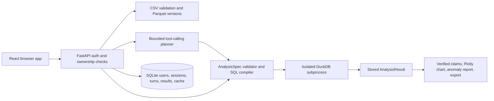

# AI Data Analyst

This repository contains a React frontend and FastAPI backend for an AI-powered CSV analyst. An authenticated user can upload CSV files, ask questions in natural language, inspect the exact SQL and bound parameters used, see validated summaries and charts, check anomalies, pin results, and export reports.

The AI provider chooses bounded analysis tools and fills a structured `AnalysisSpec`. Backend code validates that spec, computes the result in DuckDB, checks ownership again, and renders factual sentences from verified result cells. The model never supplies SQL or numbers shown as facts.

## Run locally

Requires Python 3.12 and [uv](https://docs.astral.sh/uv/). From the repository root:

```bash
cd backend
uv sync --frozen
uv run uvicorn app.main:app --host 127.0.0.1 --port 8768
```

Open [API documentation](http://127.0.0.1:8768/docs). Set `LLM_API_KEY` for natural-language questions; the deterministic `/analyze` endpoint, uploads, quality reports, saved results, and exports work without a provider. Copy `.env.example` to `.env` and set the provider endpoint, key, and model. Do not commit `.env`. The OpenAI-compatible adapter was tested with Gemini 2.5 Flash through AiCredits; its measured live evaluation is below.

For a local demo, use a temporary data directory and fictional accounts:

```bash
cd backend
export DATA_DIR="$(mktemp -d)"
export DEMO_PASSWORD='change-this-local-demo-password'
uv run app seed-demo
uv run uvicorn app.main:app --host 127.0.0.1 --port 8768
```

Accounts: `analyst1@example.com`, `analyst2@example.com`, `admin@example.com`, with the chosen demo password. Never seed demo accounts into a public deployment. For a real admin, run `uv run app create-admin --email you@example.com` and enter the password at the prompt. Analysts can sign up at `/api/auth/signup`; no HTTP endpoint can grant admin.

## Docker

`docker compose up --build -d` starts the combined frontend and backend at `http://localhost:8768`; `docker compose down` stops it while retaining the `analyst-data` volume. Pass provider and optional admin seed variables through the shell or a local `.env`. `docker compose config --quiet` validates the deployment file. The image runs as a non-root user with a read-only root filesystem, dedicated writable data volume, dropped capabilities, process/memory limits, and an isolated temporary directory. `/api/health` is liveness; `/api/ready` checks the metadata store and reports whether an AI key is configured. The image built from the final commit passed all 25 Playwright browser flows with the fake provider. No public deployment has been tested.

The current executor achieves **Tier A** isolation: a fresh subprocess per query, an environment without the API key, private copies of selected Parquet files, DuckDB external access disabled and settings locked, resource limits where the OS supports them, a wall-clock kill, and temporary-file cleanup. It executes only backend-generated SQL from validated specs. A separate network-isolated executor service (Tier B) is planned hardening and is not part of this Compose deployment. TLS, backups, and external monitoring must be configured by the deployment environment before public use.

## Frontend

React 18 + TypeScript + Vite in `frontend/`. The dev server proxies `/api` to the backend on `http://localhost:8000`; the Docker image serves the compiled frontend and API from one origin.

```bash
cd frontend
npm ci
npm run dev        # http://localhost:5173 (start the backend on :8000 first)
npm run typecheck
npm test           # Vitest component tests
npm run build      # type-checks, then writes frontend/dist
npm run e2e        # Playwright; starts the backend (LLM_PROVIDER=fake) and Vite itself
```

`npm run e2e` needs `uv` and a one-time `npx playwright install chromium`. It seeds demo accounts into a temporary data directory; override the backend command with `E2E_BACKEND_COMMAND` or reuse running servers with `E2E_REUSE_SERVERS=1`.

## Architecture



Each result records its source dataset IDs and versions. A changed dataset makes saved results and pins visibly stale. A deleted source makes them visibly missing. Retry keys prevent duplicate turns; a reused key with different input is refused. SQLite transactions serialize active-turn reservations and conversation changes.

## API workflow

All state-changing `/api` requests require `X-Requested-With: fetch`; authentication uses an HttpOnly session cookie. A typical sequence is:

1. `POST /api/auth/signup` or `/api/auth/login`.
2. `POST /api/datasets` with one or more multipart `files`; `GET /api/datasets/{id}/quality` checks quality.
3. `POST /api/conversations` with `title` and selected `dataset_ids`.
4. `POST /api/conversations/{id}/ask` with `question` and optional `request_key`. Add `?stream=true` for SSE progress and one terminal result. Without an AI key, use `POST /api/conversations/{id}/analyze` with a validated `spec`.
5. `GET /api/results/{id}`, `/chart`, or `/export?format=html|csv`; `PATCH /api/results/{id}/chart` changes only the encoding of the same stored rows. `POST /api/pins` adds a dashboard card; `GET /api/dashboard` lists it.

The result JSON contains `table`, `meta.sql`, `meta.params`, source versions, caveats, deterministic `claims` and `answer_sentences`, optional anomalies, chart spec, and real tool trace. HTML reports embed their chart and source status. CSV exports contain only the result table and prefix spreadsheet formulas. Other users' resources return 404, including for admins; only admins can change `/api/admin/settings`.

The sample data in `data/sample/` uses fictional entities. From the repository root, refresh its dates before a demo with `backend/.venv/bin/python data/generate.py`; that writes current-date sample data and keeps test fixtures pinned to 2026-09-30. Use `--reference-date YYYY-MM-DD` to pin the sample for a repeatable walkthrough. Revenue in its order data means `quantity × unit_price − discount_amount`, in GBP. A product is “underperforming” only after a user names a criterion such as revenue, units, comparison group and period; the agent asks for clarification rather than inventing one.

## Verification and boundaries

```bash
cd backend
uv run pytest
uv run ruff check .
uv run vulture app --min-confidence 80
cd .. && backend/.venv/bin/python scripts/smoke_backend.py
make eval-check           # validates 31 retail baselines without AI calls
make eval                 # runs 31 retail questions; requires LLM_API_KEY
make eval-transfer-check  # validates 10 unrelated holdout baselines offline
make eval-transfer        # runs the holdout through the live model
```

Offline tests cover CSV validation, unauthorized access, admin separation, join fan-out refusal, bound SQL values, executor escapes and limits, anomalies, claim tampering, chart/report consistency, idempotent HTTP turns, SSE clarification, and provider failure. All 31 retail and 10 transfer baselines pass without AI. On 2026-10-02, after the final agent changes, Gemini 2.5 Flash scored **29/31 answer-correct** (right table values for the requested calculation) and **25/31 exact-spec** (identical query) on the revised retail questions ([report](evals/reports/20261002T104718602620Z.md)) and **10/10** on an independent support/subscription suite with different schemas, a checked join, filters, and ranking ([report](evals/reports/20261002T104813799339Z.md)). Earlier runs of the retail suite with the same model scored 26–28/31, so expect run-to-run variation of a few cases even at temperature 0. The two remaining retail misses are model-reliability failures (a wrong count after repeated analyses, and a follow-up that exhausted its repair attempts); they were not tuned away, to avoid fitting the agent to one sample dataset. The original retail run was **19/30** ([report](evals/reports/20261002T043241262867Z.md)); its case definitions changed to resolve ambiguous order-count/average expectations, so the scores are not a controlled before/after comparison. These live reports predate two scorer changes: the runner now saves every case's actual query and table (not only failures), and answer-correctness also requires the requested sort order and any requested row limit. The next live run will be the first fully auditable one; it is pending because the provider account ran out of credit (HTTP 402) during the last attempt.

Currency: a money symbol is shown only when the dataset declares its currency (GBP, USD or EUR, set per dataset on the Data screen or with `PATCH /api/datasets/{id}`); the bundled sample declares GBP and new uploads declare none. A metric counts as money when its name or columns read as money (price, amount, revenue, cost, sales, profit, discount, spend, fee, income) and every dataset it uses declares the same currency; otherwise it is shown as a plain number. CSV exports keep 15 significant digits.

The assignment also requires a GitHub link and a 10–30 second demo video, plus screenshots and a video or live link in this README. These submission artifacts and any public deployment remain pending.

The feature-by-feature check against the supplied assignment is in [docs/ASSIGNMENT_CHECK.md](docs/ASSIGNMENT_CHECK.md).
